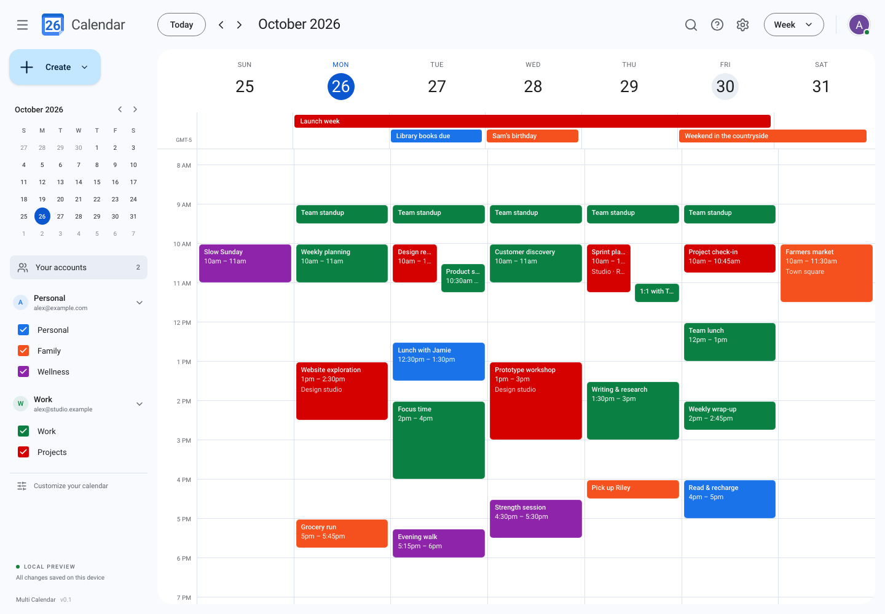

# Multi Calendar

All your calendars, one clear view.

An open-source desktop calendar built with **Tauri 2, React, TypeScript, and Vite**, using **Zustand** for interface preferences and **TanStack Query** for calendar data. The interface takes its cues from Google Calendar: a familiar sidebar, colored calendars, and a clean schedule grid. macOS is the primary desktop target; the native shell also supports Windows and Linux.

**Current status: local demo.** The app ships with fictional accounts, calendars, and events so the interface works immediately. It does not sign in to Google, read your calendars, or send invitations. Changes affect the sample data stored on your device.



## What you can try

- View multiple sample accounts and calendars together; toggle individual calendars.
- Switch between day, week, month, and schedule views.
- Create, edit, and delete local events, including all-day events.
- Search events and change display preferences.
- Keep local data between launches, with a reset option to restore the demo.

The calendar UI is implemented in React. It does not embed or scrape the Google Calendar website. Google account connectivity is a separate future integration.

## Get started

Use **Node.js 22 LTS (22.22.2 or later)** and **pnpm 10**. The exact pnpm version is recorded in `package.json`.

```sh
corepack enable
pnpm install
pnpm dev
```

Open **http://127.0.0.1:1420**. Browser preview uses browser storage for the local demo and needs no Rust toolchain, OAuth credentials, or Google Cloud project.

### Run the desktop app

Install the [Tauri platform prerequisites](https://v2.tauri.app/start/prerequisites/) and the current stable [Rust toolchain](https://rustup.rs/) (Rust 1.90 or later). On macOS, install Xcode Command Line Tools with `xcode-select --install`.

```sh
pnpm tauri dev
```

Tauri starts Vite automatically. The desktop app stores sample calendar data through the native store plugin in its application data directory. Browser preview and the desktop app use separate stores.

### Build

```sh
# Production web assets
pnpm build

# Native application and installer for your current operating system
pnpm tauri build
```

Web assets are written to `dist/`; native bundles are written to `src-tauri/target/release/bundle/`. Build installers on their target operating system. Signing, notarization, automatic updates, and public binary distribution are not configured in this initial version.

## Development checks

```sh
pnpm lint
pnpm format:check
pnpm typecheck
pnpm test
pnpm exec playwright install chromium
pnpm test:e2e
cargo fmt --manifest-path src-tauri/Cargo.toml -- --check
cargo check --locked --manifest-path src-tauri/Cargo.toml
```

The GitHub Actions workflow runs frontend checks and Chromium browser tests, plus native compile checks on macOS, Windows, and Linux. Native compilation does not replace testing each platform's desktop interface.

## Architecture

- **React + TypeScript:** calendar views, event forms, navigation, and accessible dialogs.
- **Zustand:** selected date/view, calendar visibility, theme, and display preferences.
- **TanStack Query:** repository queries, event mutations, and cache updates.
- **Repository interface:** local demo data today, an integration boundary for Google Calendar later.
- **Tauri + Rust:** a small native shell, window controls, and persistent local storage.
- **Temporal:** calendar date arithmetic and explicit handling of timed versus date-only events.

Accounts and calendar IDs remain attached to events. All-day end dates are exclusive; timed events carry explicit instants and an IANA time zone. Sample accounts and names are fictional.

## Google Calendar integration

Google sign-in and synchronization are **not implemented**. The intended next step is direct Google Calendar API access from the native layer, using the system browser, a Desktop OAuth client, and authorization code flow with PKCE. Account tokens will belong in operating-system secure storage, outside the React webview and this repository.

No credentials are needed for this demo. Do not commit Google tokens, OAuth credentials, signing certificates, or personal calendar exports. A future developer setup will use your own Google Cloud Desktop OAuth client; an installed application must not depend on keeping an embedded client secret confidential. Public OAuth distribution and Google verification will be addressed when that integration is implemented.

This app is independently developed and is not affiliated with or endorsed by Google. Google Calendar is a trademark of Google LLC. The app icon is an original asset; Google logos and proprietary product assets are not bundled.

## License

Copyright © 2026 Alex Zidros. Licensed under **GNU AGPL version 3 only** (`AGPL-3.0-only`); see [LICENSE](LICENSE). This software is provided without warranty. Dependency licenses and asset attribution are documented in [THIRD_PARTY_NOTICES.md](THIRD_PARTY_NOTICES.md).
